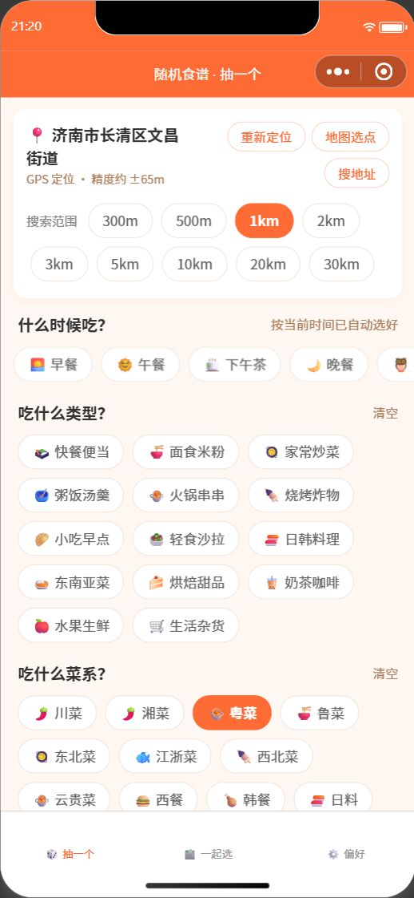
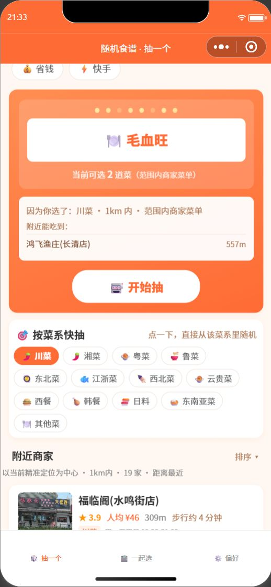
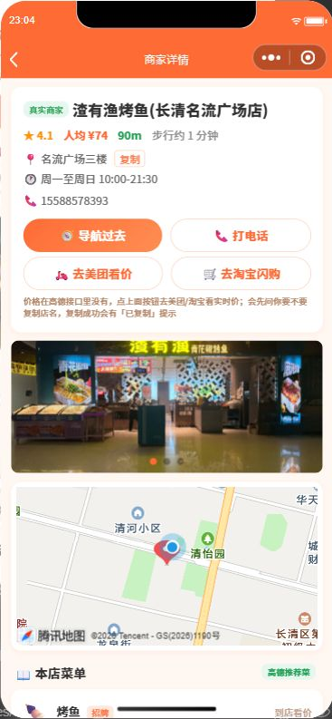

# 随机食谱 🎲

> 一个微信小程序：**按你当前定位，随机抽一道附近真能吃到、预算和口味都对得上的菜** —— 专治「今天吃什么」。

[](https://developers.weixin.qq.com/miniprogram/dev/framework/)
[](https://github.com/mzy8262-svg/random-recipe/releases)
[](LICENSE)
[](https://github.com/mzy8262-svg/random-recipe/stargazers)

<p align="center">
  
  
  
</p>
<p align="center"><sub>左：定位 + 场景/品类/菜系筛选　中：抽到「毛血旺」，直接告诉你附近哪家店有　右：真实商家详情，可跳美团看价</sub></p>

## 5 分钟跑起来

1. 安装 [微信开发者工具](https://developers.weixin.qq.com/miniprogram/dev/devtools/download.html)，登录微信
2. 导入本目录（`D:\mathtype\random-recipe`）；没有 AppID 就选「测试号」
3. 申请一个免费的高德 **Web 服务** Key（[控制台](https://console.amap.com/dev/key/app)），复制 `utils/config.example.js` 为 `utils/config.local.js`，把 Key 填进去
4. 点「编译」即可运行：抽签、筛选不联网也能用；定位/附近商家需要 Key 和网络

> **为什么仓库里没有 Key**：高德 Key 属于个人凭证，放在本地 `utils/config.local.js`（已被 `.gitignore` 忽略），仓库只提交模板 `config.example.js`。克隆后自己填一个就能跑。

## 免责声明

商家名称、地址、电话、评分、推荐菜等数据来自[高德开放平台](https://lbs.amap.com/)，仅供学习与个人使用；商用请自行申请高德授权。菜品热量为估算值，价格以门店为准。

---

## 功能

## 功能

| 功能 | 说明 |
|---|---|
| 🎰 随机食谱抽签 | 老虎机动画随机抽菜，带减速定格效果 |
| 📍 分级定位 | 隐私授权 → GPS 高精度（差就持续定位挑最准）→ IP 定位 → 地图选点 / 搜地址，自动降级；界面直接显示「精度约 ±40m」或「IP 定位仅城市级」 |
| 📏 范围筛选 | 300m / 500m / 1 / 2 / 3 / 5 / 10 / 20 / 30 公里可选（最远 30km），列表以当前定位点为中心、由近到远，带步行/骑行时间 |
| 🗂️ 三层分类 | 场景（早/午/下午茶/晚/夜宵）× 品类（14 类）× 预算（4 档）× 标签 |
| 🍜 菜系筛选 | 川菜/湘菜/粤菜/鲁菜/东北菜/江浙菜/西北菜/云贵菜/西餐/韩餐/日料/东南亚菜/其他菜共 13 类；同时作用于抽签菜库和附近商家搜索关键词；抽签卡下方还有「按菜系快抽」（点一下直接抽） |
| 🏪 真实商家 | 高德开放平台周边搜索：真实店名、地址、评分、人均、营业时间、门店照片 |
| 🥗 忌口记忆 | 8 种忌口 + 4 种饮食目标，抽签自动排除，本地持久化 |
| 🔥 热量显示 | 每道菜带估算千卡，减脂期模式只抽 500 千卡以内 |
| 🗺️ 地图导航 | 商家详情页内置地图 + 一键导航 + 拨打电话 |
| 🗳️ 多人一起选 | 抽 4 个候选大家投票，自动选出得票最高，可分享 |
| 📴 离线可用 | 菜库 / 抽签 / 筛选 / 投票全部打包在本地，断网也能用；页面顶部自动提示「当前离线」；定位、附近商家、导航需要联网，网络恢复后自动重拉商家 |

> 菜系筛选是后加的功能：① 抽签菜库按菜系过滤（如选「粤菜」只从粤菜里抽）；② 附近商家按菜系关键词搜（如 `粤菜|广东菜|烧腊|煲仔饭`）；③ 抽签卡下方「按菜系快抽」点一下 = 选中该菜系并立刻抽一道；④ 选菜系后如果当前时段没有这类菜，会自动取消时段限制并提示，不会让你看到「可选 0 道菜」；⑤ 附近搜不到该菜系的店时，列表自动回退成「全部餐饮」并在顶部注明，避免一片空白；⑥ 只要附近商家有推荐菜（高德 tag/atag），抽签池就优先用「范围内商家的真实菜单」，抽到的菜附近一定有店，结果里直接给出那家店（详见下方第 7 条）。

## 本次修复了什么（重要）

上一个版本「不好用」，根因有七个，都已修复：

1. **定位总失败 / 非要手动输地址 / 定不准**
   - 旧代码 `wx.getLocation` 失败后直接 `wx.getLocation` 重试，没有处理微信 2023 年起强制的「隐私保护指引」授权，真机上会一直 fail。
   - 现在：先 `wx.getPrivacySetting` → `wx.requirePrivacyAuthorize` 拉起授权，再 GPS；权限被拒时给出「去开启」（`wx.openSetting`）入口，并自动降级到高德 IP 定位；都失败还能用「搜地址」或「地图选点」手动选点。启动时先用上次定位秒开。
   - **精度也管了**：GPS 用 `isHighAccuracy`；首次定位精度差（>200m）时自动持续监听 3 秒取最准的一次（≤60m 提前停止省电）；界面直接显示「GPS 定位 · 精度约 ±40m」；IP 定位明说「城市级，可能偏差几公里」，并提示用「地图选点」（`wx.chooseLocation`）拖地图精确到楼下。
   - `app.json` 已加 `__usePrivacyCheck__: true`，`permission.scope.userLocation` 与 `requiredPrivateInfos: ["getLocation", "chooseLocation"]` 已声明。

1.5 **精准定位找附近商家**
   - 商家搜索始终以「当前定位点」为圆心：半径可从 **300m** 收窄（GPS 高精度 / 地图选点后），也能放大到 **10 / 20 / 30km**（跨区找店，高德接口允许范围），列表按真实距离由近到远，并显示「步行约 N 分钟」。
   - 列表顶部直接写明依据：「以地图选点位置为中心 · 300m内 · 25 家 · 距离最近」，避免“这到底按哪定位搜的”疑问。
   - 高德偶尔缺 `distance` 字段，会用经纬度本地 Haversine 重算兜底，不会出现空白距离；用菜名找店时最小仍搜 1km，避免半径 300m 时搜不到。

2. **附近商家混进快递驿站、住宅小区等无关店铺**
   - 旧代码周边搜索没传 `types`，把「生活服务 / 物流速递 / 商务住宅」全搜出来了（你截图里的「齐鲁工业大学快递驿站」就是这么来的）。
   - 现在：餐饮统一传 `types=050000`，水果生鲜/生活杂货传 `types=060000`；并在 `utils/poi.js` 里再做一层类型过滤（`isFoodPoi` / `isShopPoi`），快递/驿站/住宅/银行等直接丢弃。

3. **详情页菜单是假菜假价**
   - 旧代码按「品类 + 人均」编造 8 道菜并缩放价格（鱼香肉丝 ¥22 之类），还标成「本店菜单」。
   - 现在：只展示有真实来源的菜 —— 人工录入的 `utils/seed-menus.js`（标「真实菜单」）或高德 POI 的推荐菜标签（标「高德推荐菜」，只有菜名没有价格，显示「到店看价」）；两者都没有就明确提示「线上暂无菜单，导航到店选」，**绝不编造**。

4. **菜品行、按钮点不了，像贴图**
   - 旧详情页菜品行没有事件；高德的 `tel`/`biz_ext` 字段可能是数组 `[]`，直接渲染成空白、`t.split` 还会崩。
   - 现在：菜品行可点 →「就吃这个，记到首页 / 复制菜名」（记下后首页 `onShow` 自动接住，形成"抽菜 / 选菜 → 找附近能吃的店 → 到店"闭环）；电话用 `utils/poi.firstTel` 归一化；无坐标不调导航而是提示复制地址；门店照片可点开大图；首页下拉刷新 + 触底加载更多 + 排序。

5. **「吃什么类型」「有什么要求」点了没反应，连带着抽签也觉得点不动**
   - 原因：WXML 模板里不能调用函数。旧模板写的是 `{{catIds.indexOf(item.id) >= 0 ? 'active' : ''}}`，这个表达式在模板里求不出值，而是一直判为假 —— 所以点一下既不变橙色、也不报错，看起来就是“死”的；接着用户以为抽签按钮也没生效。
   - 现在：改成预计算的选中表 `catOn` / `tagOn`（偏好页是 `prefOn`），点一下立即变橙、再点取消，抽签池数量同步变化。已用微信开发者工具官方自动化在模拟器里真实点击验证（点品类 → 高亮 + 可选菜数 51→10；点标签 → 高亮 + 可选菜数 →2；点抽签 → 正常抽出「麻婆豆腐盖饭」）。
   - 顺带：已上传 **1.0.2** 版本（v1.0.0 修定位/商家/假菜单，v1.0.1 修筛选高亮，v1.0.2 修下面第 6 条 + 推荐菜去噪）。

6. **定位成功了，但「附近商家」一直空着**
   - 原因：启动时 `app.js` 把上次定位恢复到 `globalData`，页面又先用缓存 `applyLocation` 一次；缓存点和 GPS 点通常就是同一个点，`applyLocation` 里只有“坐标明显变化（moved）”才拉商家 —— 于是 `place/around` 请求根本没发出去，界面有定位、有精度、列表却空着，看着像“搜不到店”。
   - 现在：`applyLocation` 在「列表为空且没在加载」时也拉一次；坐标变了照旧重拉；`skipLoad`（重新定位先用缓存秒开）不重复请求。开发者工具模拟器实测：修复前 `merchants=0` 且网络面板无 `place/around` 请求，修复后 `merchants=25`、`listTip=以当前精准定位为中心 · 1km内 · 25 家 · 距离最近`。
   - 顺带把「高德推荐菜」去噪：`（2-3人餐）`、`安格斯系列` 这类整体是套餐/系列的词不再当作菜名显示。

7. **菜系抽出来的菜不像这个菜系 / 范围内商家不全**
   - 原因一：抽签只在「内置菜库」里随机，跟“附近到底有没有店做这道菜”完全没关系 —— 选了粤菜可能抽到一家 1km 内根本没有的菜。
   - 原因二：商家列表每次只取第一页 25 家（按距离排），1km 内往往远不止 25 家，看着像“商家不全”。
   - 原因三：高德推荐菜里很多菜名对不上内置菜库，一旦用户设了预算/标签/忌口，这些真实菜会被整片过滤掉，池子只剩几道。
   - 现在：新增 `utils/dishpool.js` —— 把「所选范围内商家的真实推荐菜」直接变成抽签池（`池子里的每道菜都带 merId / 店名 / 距离`），抽到的菜一定来自范围内某家店，抽完直接把那家店（含距离、评分、电话、营业时间、照片）摆在结果里；范围菜单里没有该菜系/该条件时，退回内置菜库并在界面写明「范围内没匹配的菜单，用内置菜库」；`附近商家` 改成“首屏先出第一页 25 家、后台再静默补全第 2~8 页”（实测 1km 内 25 家 → 199 家，按 `MAX_MERCHANT_ROWS=200` 截断；高德 QPS 限流 `CUQPS` 会自动重试，不会把列表打空）；页面新增「🍽️ 范围内菜品」卡片，把范围内所有商家的推荐菜汇总成一张表（实测 165 道，带价格「到店看价」+ 店名 + 距离），点任意一道菜直接选中并显示那家店。
   - 忌口也补了菜名兜底：真实菜名对不上菜库时，用「猪/肉/鱼/虾/牛/辣/奶/香菜」等关键词保守排除，避免把「水煮鱼」推给不吃辣的人。


## 去美团看价 / 去淘宝闪购（价格按钮）

高德接口只有「人均消费」，没有单品价格，所以菜品行显示「到店看价」。为了能看实时价格，加了两个按钮，并且**每次点都会先问一句「要不要复制店名」**：

| 按钮 | 点下去发生什么 |
|---|---|
| 🛵 去美团看价 | 先弹「店名：XXX，复制并跳转 / 直接跳转」：选「是」→ 复制店名后打开美团小程序；选「否」→ 不复制，也照样打开美团。进美团后长按搜索框粘贴即可找到这家店 |
| 🛒 去淘宝闪购 | 先弹「店名：XXX，复制店名 / 不复制」。微信里没有淘宝小程序、也打不开淘宝链接（平台限制），所以：选「是」→ 复制店名并提示去淘宝 App 粘贴；选「否」→ 说明原因并再问一次要不要复制，不会静默失败 |

按钮出现在三处：抽签结果卡的「附近能吃到」每行、抽签结果卡底部、商家详情页（菜品长按菜单里也有「去美团搜这道菜 / 去淘宝搜这道菜」）。

**复制到底复制了什么（1.0.9 修正）**：

- 商家详情页：地址行后面的「复制」标签、以及无电话时的「📋 复制店名/地址」按钮 → **复制「店名 + 地址」**（以前只复制地址，所以看着像没复制店名）；
- 抽签结果卡的两个按钮 → 优先复制「附近能吃到的那家店名」，没有店名才退回菜名（以前这里复制的是菜名）；
- 复制成功会弹「已复制店名：XXX」提示；复制失败会弹窗把要复制的内容显示出来，让你手动抄，不会静默；
- 复制失败会自动重试一次（`wx.setClipboardData` 偶发失败时）。

**长按选中复制（1.0.10）**：

- 商家详情页的店名、地址、电话、营业时间、评分、人均、菜名、热量，以及首页抽签结果里的菜名/店名，都加了 `user-select`，**长按文字会出现系统的「选择/复制」菜单**，可以只选一部分复制；
- 地图卡片里的地名、照片上的字属于地图组件/图片内容，无法选中（平台限制）；
- 复制失败（比如剪贴板被系统占用）时不再只弹一句提示，而是弹出**「手动复制面板」**：把要复制的文字整段列出来、文字可长按选中，方便手动抄；
- 地址行右侧的复制入口改成了明显的「复制店名」按钮（以前只是个很小的「复制」字）。

**「点了必须有反应」的兜底设计**（`utils/jump.js`）：
1. 正常：先问复制 → 复制成功后再跳（美团）/ 复制后给淘宝指引；
2. 对「不复制」：美团照样直接跳；淘宝说明平台限制并给第二次复制机会；
3. 跳不过去（对方限制 / appId 失效 / 微信版本旧 / 基础库不支持）→ 自动复制店名 + 弹窗告诉你怎么去对应 App 搜；
4. 空店名（比如还没抽到菜就点）→ 明确提示「先抽一个菜」，不会出现「请手动记住店名：（空白）」。

美团 appId 在 `utils/config.js` 的 `EXTERNAL_APPS.meituan.appId`，留空则自动降级为复制兜底；想换成大众点评/饿了么改这里即可。

> 说明：淘宝/淘宝闪购属于阿里系，微信内既没有对应小程序、也不允许直接打开淘宝链接。「一键跳淘宝」在微信小程序里做不到，只能复制店名后去淘宝 App 搜——这是平台限制，不是程序问题。

## 上传到 GitHub（只提交代码，不提交高德 Key）

仓库里**没有真实 Key**：`utils/config.js` 会用 `resolveKey()` 按顺序找 Key——① `utils/config.local.js`（本机私有、被 .gitignore 忽略）② 浏览器里的 `window.__LOCAL_AMAP_KEY__` ③ 都没有就退回占位符 `PUT_YOUR_AMAP_KEY_HERE`（此时定位/附近商家会提示「高德 Key 无效」，抽签、筛选、偏好、投票仍可用）。

| 文件 | 是否提交 | 说明 |
|---|---|---|
| `utils/config.js` | ✅ 提交 | 只有占位符和解析逻辑 |
| `utils/config.example.js` | ✅ 提交 | 模板，告诉别人怎么填 |
| `utils/config.local.js` | ❌ 不提交 | 你本机的真实 Key（已写进 .gitignore） |
| `project.private.config.json` | ❌ 不提交 | 开发者工具的本机编译设置，提交了容易冲突 |
| `__pycache__/`、`*.pyc` | ❌ 不提交 | Python 缓存 |

首次提交（先装 Git for Windows 或 GitHub Desktop）：

```powershell
cd D:\mathtype\random-recipe
git init
git add .
git commit -m "feat: 随机食谱小程序 v1.0.11"
# 在 GitHub 网页 New repository（不要勾 README），然后：
git remote add origin https://github.com/<你的用户名>/random-recipe.git
git branch -M main
git push -u origin main
```

推之前自检（应输出 .gitignore 规则、且不出现 Key 文件）：

```powershell
git status --short          # 不应看到 utils/config.local.js
git check-ignore -v utils/config.local.js
```

换机器 / 别人克隆后：复制 `utils/config.example.js` 为 `utils/config.local.js`，填入自己的高德 Key 即可。**真实 Key 只留在本地、永不进仓库。**

## 发给别人用 / 离线能力（重要）

先说结论：**微信小程序没有「打包成文件发给别人、永久离线使用」这种模式**。小程序的代码包由微信托管，第一次打开必须联网从微信服务器下载（之后微信会缓存，弱网也能开），而且「附近商家 / 定位 / 导航」调的是高德在线接口，断网必然不可用。能离线的是「抽签 / 筛选 / 投票」这一半——菜库 100+ 道菜全部打包在小程序里，不联网也能玩。

想让别人在微信里长期使用，有两条正路：

**A. 体验版（最快，免审核，适合亲友小范围）**

1. 用你自己的身份在 [mp.weixin.qq.com](https://mp.weixin.qq.com/) 注册小程序，拿到自己的 **AppID**
2. 把 `project.config.json` 里的 `appid` 换成你的（现在是 `wx5a88d9f2e77d71ff`，**这是别人的 AppID，你无法上传**）
3. 微信开发者工具里「上传」→ 在小程序后台「版本管理」里把它设为**体验版**
4. 后台「成员管理」→ 把朋友的微信号加为**体验成员**（个人小程序最多 15 人）
5. 把体验版二维码发给朋友，扫码即用。**长期有效、不用审核**，但只有体验成员能打开

**B. 正式发布（任何人可搜可用，需要审核）**

1. 同上注册 AppID、配置合法域名与隐私声明
2. 开发者工具「上传」→ 后台「提交审核」→ 通过后「发布」
3. 之后任何人可以在微信里搜「随机食谱」、扫小程序码或接收分享卡片使用；不依赖你的电脑
4. 注意：个人主体的可选类目有限，「餐饮推荐」类内容可能被要求资质。比较稳的定位是「工具 > 效率 / 随机选择器」，并在描述里强调“随机帮你决定吃什么”

无论 A 还是 B，都需要先做两件配置（否则真机上商家列表为空）：

- 后台「开发管理 → 开发设置 → 服务器域名 → request 合法域名」加 `https://restapi.amap.com`
- 「设置 → 服务内容声明 → 用户隐私保护指引」声明「位置信息」用途

逐步骤的操作手册见 **[PUBLISH.md](PUBLISH.md)**（导入项目 → 后台配置 → 上传 → 体验版 / 审核发布 → 常见报错对照）。

**C. 网页版（演示页）想发给别人**：`web-demo/server.py` 需要跑在一台公网服务器上（或换成云函数/Serverless 做高德代理，因为浏览器直连高德会跨域），部署后把 URL 发出去即可；网页版同样需要联网，不是离线方案。

### 关于「别人不在我这儿」——定位是按每个人的设备算的

- **微信小程序**：`wx.getLocation` 永远取的是**使用者本人手机**的坐标，不存在“定到开发者位置”的情况。A 的朋友在另一个城市打开，看到的就是他自己附近的商家。
- **网页演示版**：优先用浏览器 GPS（浏览器会问“是否允许获取位置”），允许后是访客本人坐标；拒绝时用 IP 定位——这里之前有个坑：页面通过服务器代理请求高德，高德看到的是**服务器的 IP**，所以所有访客都被定到服务器所在城市。现已修成把**访客真实 IP**（`X-Forwarded-For` / TCP 对端）传给高德 `v3/ip`，异地朋友打开会定到他自己城市；两者都失败时不再默默用“济南默认坐标”，而是明确提示「定位失败」并自动展开「搜地址」。
- **同一 WiFi 临时分享**：`python web-demo/server.py` 现在默认监听 `0.0.0.0`，启动会打印「局域网: http://你的内网IP:8787」；朋友连同一 WiFi 用这个地址打开，就能按他自己的设备定位（只是给自己临时看，不是长期方案）。
- 长期给别人用，仍然要走上面 A（体验版，≤15 人）或 B（正式发布）。

高德 Key 免费额度约「周边搜索 5,000 次/月」，15 个体验成员日常用足够；公开发布前建议换用自己的 Key 或加服务端转发隐藏 Key，见文末。

## 目录结构

```
random-recipe/
├── app.js / app.json / app.wxss     全局配置与样式
├── project.config.json              开发者工具项目配置
├── utils/
│   ├── config.js                    高德 Key、半径档位、POI 类型码
│   ├── amap.js                      高德 API 封装（IP定位/周边搜索/地理编码/地址搜索）
│   ├── poi.js                       POI 字段清洗（数组 [] 兜底）、餐饮/购物判定、菜名提取
│   ├── menu.js                      商家菜单（只取真实来源，禁止编造）
│   ├── seed-menus.js                人工录入的真实菜单
│   ├── geo.js                       Haversine 距离计算
│   ├── data.js                      分类体系 + 100+ 道菜品库（含热量/忌口标记）
│   └── store.js                     偏好/历史/上次定位本地存储
└── pages/
    ├── index/    抽签主页（定位、筛选、老虎机、附近商家列表）
    ├── detail/   商家详情（照片、地图、导航、电话、真实菜单/选菜）
    ├── vote/     多人投票
    └── prefs/    偏好设置（忌口、目标、历史）
```

## 如何运行

1. 安装 [微信开发者工具](https://developers.weixin.qq.com/miniprogram/dev/devtools/download.html)
2. 「导入项目」→ 选择 `D:\mathtype\random-recipe` 目录
3. AppID：`project.config.json` 里已配 `wx5a88d9f2e77d71ff`；换成你自己的 AppID 也行
4. 编译运行

## 自检（可选，无需打开开发者工具）

项目里没有构建依赖，直接用 Node 跑逻辑回归即可（`D:\DSH\random-recipe-verify\` 下）：

```bat
node run.js          :: 39 项：模块契约 / 高德字段清洗 / types 过滤 / 假菜单清除 / 菜品点击闭环 / 定位降级
node loc-accuracy.js :: 10 项：GPS 精度优选、精度文案、地图选点、授权失败兜底
node offline.js      :: 11 项：断网提示、抽签离线可用、网络恢复自动重拉、卸载清理监听
node nearby.js       :: 12 项（真实高德接口）：300/500m 精准找店、以定位点为中心、距离排序与兜底
node publish-check.js :: 25 项（含「仓库不含真实 Key」检查） :: 22 项：发布配置自检（AppID、页面四件套、隐私声明、上传排除项、包体积）
node chip-state.js   :: 20 项：筛选 chip 高亮（WXML 里不得再出现 indexOf 之类的函数调用；catOn/tagOn/prefOn 增删复位）
node firstload.js    :: 14 项：首次进入列表为空也必须拉商家、坐标变化重拉、IP/GPS 精度文案、非法坐标兜底
node radius.js       :: 17 项：范围档位 300m~30km、上限 30km 夹取、默认仍 1km、web-demo 同步
node cuisine.js      :: 94 项：13 个菜系结构完整、菜名归类、filterDishes 逐菜系、商家关键词、快抽自动放开时段、商家回退全部餐饮
node rangepool.js    :: 34 项：范围内商家菜单当抽签池（菜一定在范围内）、同名菜取最近店、忌口菜名兜底、时段兜底、范围内没菜系时回退内置菜库、8 页深度翻页（首屏先出第一页、CUQPS 限流自动重试）、范围内菜品全览/展开/点选
node external.js     :: 53 项：美团/淘宝按钮（先问复制、复制后跳、不复制也跳、失败兜底、空店名保护、页面接线）
node demo.js         :: 用真实高德接口对比“修复前 vs 修复后”的周边搜索结果
```

## ⚠️ 真机运行前必做：配置合法域名 + 隐私

1. 登录 [mp.weixin.qq.com](https://mp.weixin.qq.com/)（小程序管理后台）
2. 「开发管理」→「开发设置」→「服务器域名」→ **request 合法域名** 添加 `https://restapi.amap.com`
3. 「设置」→「服务内容声明」→「用户隐私保护指引」里声明「位置信息」用途（`getLocation` 与 `chooseLocation` 地图选点都归在这一类，否则隐私弹窗无法通过）

开发阶段不用配域名：微信开发者工具 →「详情」→「本地设置」→ 勾选「不校验合法域名」（本项目 `project.config.json` 已设 `urlCheck: false`）。

## 关于数据

- **商家数据是真实的**：来自高德开放平台「周边搜索」，店名、坐标、地址、评分、人均、营业时间、照片均为高德收录的真实数据，距离按定位实时计算。
- **抽签菜库是参考库**：100+ 道菜的热量/价格是内置生活化数据，抽签用来做选择，不代表某家店的实际售价。
- **商家详情菜单**：只有人工录入或高德标签才有菜名，没有价格就显示「到店看价」，没有数据就提示到店选。不再有「演示菜单」。
- **美团/淘宝闪购**：其商家接口需要企业资质 + AppKey，暂未接入；`utils/amap.js` 的封装模式可直接复制成 `meituan.js` 平替。

## 高德 Key

`utils/config.js` 里的 Key 是个人开发者 Web 服务 Key，免费额度：周边搜索 5,000 次/月、地理编码 150,000 次/月，自己日常用够了。公开发布建议换用自己的 Key 或走服务端转发隐藏 Key。

## 免责

本项目仅供个人学习与日常使用。商家信息以高德地图数据为准；抽签菜库的热量与价格为估算值，仅供参考。
